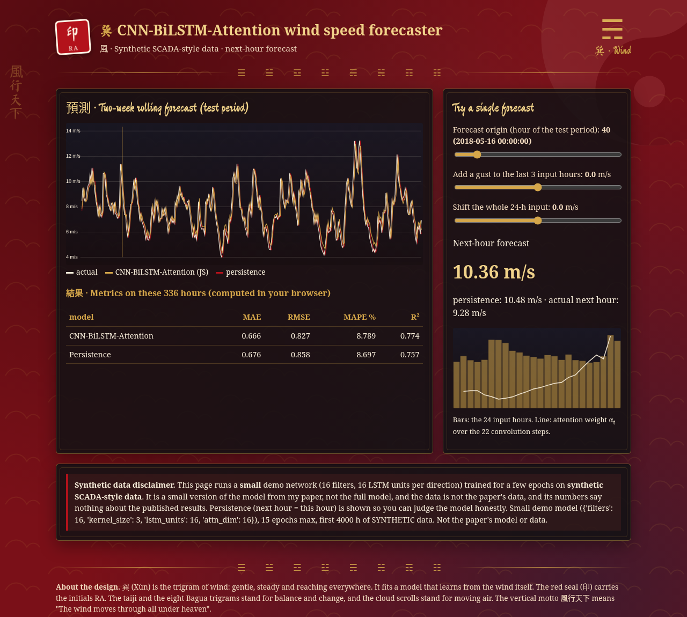

# CNN-BiLSTM-Attention for Short-Term Wind Speed Forecasting on Synthetic SCADA Data (PyTorch)

<a href="https://rishabh-bgp.github.io/cnn-bilstm-attention-synthetic-scada/"></a>

[](https://rishabh-bgp.github.io/cnn-bilstm-attention-synthetic-scada/) [](https://github.com/Rishabh-bgp/cnn-bilstm-attention-synthetic-scada/actions/workflows/ci.yml) [](https://colab.research.google.com/github/Rishabh-bgp/cnn-bilstm-attention-synthetic-scada/blob/main/notebooks/walkthrough.ipynb) [](LICENSE)  

Hybrid deep learning (1-D CNN + bidirectional LSTM + soft attention) for next-hour wind speed forecasting, benchmarked against ARIMA, SVR, XGBoost, Random Forest and LSTM on a synthetic SCADA-style dataset, with Diebold-Mariano tests and residual diagnostics. Renewable energy / wind power time-series forecasting, M.Tech thesis work, IIIT Bhagalpur. The paper proposes a **CNN–BiLSTM–Attention** model for short-term wind speed forecasting and validates it on **synthetic SCADA-style data** before real deployment. A 1-D CNN extracts local patterns from the last 24 hours, a BiLSTM captures forward and backward dependencies, and soft attention weights the most informative hours. The model is benchmarked against ARIMA, SVR, XGBoost, Random Forest and LSTM, with residual diagnostics and Diebold–Mariano tests.

<a href="https://rishabh-bgp.github.io/cnn-bilstm-attention-synthetic-scada/"></a>

**Live demo:** https://rishabh-bgp.github.io/cnn-bilstm-attention-synthetic-scada/ (runs entirely in your browser on synthetic data)

**About the demo design.** The page uses a Daoist, Chinese-ink style: crimson, charcoal and navy with gold accents, brush-style headings in the Ma Shan Zheng font, and charts drawn in gold, red and ink. Each repository has its own trigram. This one is **巽 ☴ (Xùn, Wind)**. 巽 (Xùn) is the trigram of wind: gentle, steady and reaching everywhere. It fits a model that learns from the wind itself. The red seal stamp (印) carries the initials RA, the faint taiji and the row of eight Bagua trigrams stand for balance and change, the cloud scrolls stand for moving air, and the vertical motto 風行天下 means "The wind moves through all under heaven". The design is purely decorative. Everything is computed by the model shown, on synthetic data.

## What this repository implements

- A **synthetic SCADA-style generator** (8,760 hourly values: seasonal cycle with March/December maxima and a July-August monsoon minimum, 24-h diurnal sinusoid, right-skewed stochastic term, ~0.2 % missing values, slow sensor drift), linear interpolation of gaps.
- The proposed **CNN-BiLSTM-Attention** hybrid and the five baselines from the paper: **ARIMA** (AIC-selected order), **SVR** (RBF, grid search), **XGBoost** (grid search), **Random Forest** (300 trees), **LSTM** (1 layer, 64 units). Shallow-model hyper-parameters are tuned with 5-fold time-series CV on the training set.
- MAE, RMSE, MAPE, R2; Ljung-Box (lag 24), Shapiro-Wilk, Breusch-Pagan; pairwise Diebold-Mariano; RMSE stratified into low (<5), medium (5-10) and high (>10 m/s) wind bands.

## 架構 · Architecture

```
input  : last 24 hourly wind speeds (min-max scaled, scaler fit on train only)
Conv1D : 64 filters, kernel 3, ReLU            -> (22 x 64)
BiLSTM : 64 units per direction, full sequence -> (22 x 128)
Soft attention: e_t = v^T tanh(W_a h_t + b_a), alpha = softmax(e), c = sum alpha_t h_t
Dense  : 1 unit = predicted CHANGE from the last reading
output : forecast = last reading + predicted change
```
Training: Adam (lr 0.001), MSE loss, batch 32, up to 100 epochs, early stopping (patience 10), fixed seed 42.
Data split: chronological 80 % train / 20 % test; 24 -> 1 sliding window.
Target: every learned model (deep and shallow) predicts the **change from the last reading** (`target: delta` in the config; set `target: level` to predict the value directly). Persistence is the special case where the predicted change is zero.

## Quick start

```bash
python -m venv .venv && source .venv/bin/activate   # Windows: .venv\Scripts\activate
pip install -r requirements.txt
python train.py --quick      # smoke test: 3 epochs, short series, small grids
python train.py              # full run with the paper's settings
python -m pytest -q          # tests (incl. JS-vs-Python demo check; needs Node.js)
```

Outputs in `results/`: `metrics.csv` (MAE, RMSE, MAPE, R2 per model), `predictions.csv`,
`details.json` (Diebold-Mariano tests vs the hybrid, Ljung-Box / Shapiro-Wilk / Breusch-Pagan
residual diagnostics, wind-regime stratified RMSE, RMSE reduction %, loss curves).

Repository layout:

```
src/windforecast/  data.py (loader, synthetic generator, windowing, scaling)
                   models.py (CNN-BiLSTM-Attention and baselines)
                   metrics.py, stats.py (DM test, residual diagnostics)
                   experiment.py (end-to-end runner)
configs/default.yaml   train.py   tests/   notebooks/walkthrough.ipynb
scripts/make_synthetic_data.py   scripts/export_demo_model.py   demo/ (GitHub Pages source)
data/synthetic/synthetic_scada.csv (SYNTHETIC)
```

## Notebook

[](https://colab.research.google.com/github/Rishabh-bgp/cnn-bilstm-attention-synthetic-scada/blob/main/notebooks/walkthrough.ipynb)

[`notebooks/walkthrough.ipynb`](notebooks/walkthrough.ipynb) is a beginner-friendly, self-contained version of the code, with explanations in plain words. It runs in Colab or in Anaconda Jupyter on Windows, macOS or Linux:

1. Load the synthetic SCADA-style CSV (local file, else download from GitHub, else generate it).
2. Fill gaps and split 80/20 by time.
3. Scale to [0, 1], fitting the scaler on training data only.
4. Turn the series into 24-hour input windows with a 1-hour target.
5. Build the CNN–BiLSTM–Attention model.
6. Train it briefly (up to 20 epochs with early stopping).
7. Compare MAE, RMSE, MAPE and R² with a persistence baseline.
8. Plot actual vs predicted.

## 數據 · Data

**The original SCADA dataset used in the paper is not publicly available** (it is confidential and
is not, and will never be, included in this repository).

- `data/synthetic/synthetic_scada.csv` is a **SYNTHETIC** hourly SCADA-style wind speed series generated by
  `scripts/make_synthetic_data.py` (seed 42). It is committed only so the code runs out of the box.
  It is not measured data, and results on it say nothing about the published results.
- To use your own data locally, put a CSV anywhere under `data/` (for example `data/scada.csv`)
  with columns `timestamp,wind_speed` (other names: set `timestamp_col` / `wind_col`; 10-minute data is mean-resampled to hourly), and point `data.csv` in `configs/default.yaml` at it. Everything in `data/` except the
  committed synthetic CSV is git-ignored, so your file will not be committed.

## 結果 · Results (honest, synthetic data)

These are the real numbers from runs on the **synthetic** CSV. They are not the paper's results, and they are not tuned to match them. Every learned model predicts the **change from the last reading**, so persistence (change = 0) is the honest baseline to beat.

**1. Smoke test** (`python train.py --quick`: first 2,000 hours, 3 epochs, small hyper-parameter grids; test = last 400 hours):

| Rank | Model | MAE (m/s) | RMSE (m/s) | MAPE (%) | R² |
|---:|---|---:|---:|---:|---:|
| 1 | ARIMA | 0.598 | 0.750 | 8.07 | 0.734 |
| 2 | LSTM | 0.593 | 0.750 | 7.96 | 0.734 |
| 3 | CNN-BiLSTM-Attention | 0.602 | 0.762 | 7.97 | 0.725 |
| 4 | **Persistence** | 0.597 | 0.764 | 7.87 | 0.723 |
| 5 | XGBoost | 0.612 | 0.775 | 8.23 | 0.716 |
| 6 | Random Forest | 0.632 | 0.805 | 8.54 | 0.693 |
| 7 | SVR | 0.768 | 0.970 | 10.31 | 0.555 |

Does CNN–BiLSTM–Attention beat persistence? RMSE 0.762 vs 0.764 m/s (beats persistence), MAE 0.602 vs 0.597 m/s (does not beat persistence). Models with lower RMSE than persistence in this run: ARIMA, LSTM, CNN-BiLSTM-Attention. The margins are small, and three epochs are a smoke test, not a tuned result.

**2. Small demo model** (the one on the live demo: 16 filters, 16 LSTM units per direction, up to 15 epochs, first 4,000 hours; test = last 800 hours):

| Model | MAE (m/s) | RMSE (m/s) | MAPE (%) | R² |
|---|---:|---:|---:|---:|
| CNN–BiLSTM–Attention (small) | 0.614 | 0.771 | 8.49 | 0.750 |
| **Persistence** | 0.617 | 0.795 | 8.35 | 0.734 |

Does it beat persistence? RMSE 0.771 vs 0.795 m/s (beats persistence), MAE 0.614 vs 0.617 m/s (beats persistence). On this smooth synthetic series, persistence is a strong baseline, so any gain is modest.

## Reference implementation note

> **Reference implementation.** This repository is a reference implementation of my own paper (cited below), rebuilt in Python and run on synthetic data because the original SCADA data is confidential. Results from this code will differ from the numbers published in the paper, and this repository does not claim to reproduce them.

### Assumptions and deviations from the paper

- The paper names the generator's components but not its constants; amplitudes/noise parameters in `data.generate_synthetic_scada` are assumptions chosen to give mostly 6-9 m/s with a slight right skew.
- The attention description in the paper text is truncated ("a soft-attention layer that used."); standard additive (Bahdanau-style) soft attention over the BiLSTM states is used, as formulated in the companion mathematical-formulations paper.
- Exact SVR / XGBoost grids are not given; the grids in the config are assumptions.
- Deep models are implemented in **PyTorch**; the paper used TensorFlow/Keras.
- The early-stopping validation set is the last 10 % of the training windows (not stated in the paper).
- Attention hidden size d_a = 64 and no dropout (not stated in the paper).
- MAPE ignores hours with |y| < 0.1 m/s to avoid division by ~0 (handling not stated).
- ARIMA is evaluated as rolling one-step-ahead forecasts (parameters fit on train only), matching the 1-step horizon of the other models.

## Citation

R. Aryan and T. Hiwarkar, "Hybrid deep learning models with attention mechanisms for short-term wind speed forecasting: A comprehensive review and benchmarking of CNN–BiLSTM–Attention using synthetic SCADA-style data for robust preliminary validation," *IJMEC*, 2026. [Online]. Available: https://ijmec.com/index.php/multidisciplinary/article/view/1075

## License

MIT License, © 2026 Rishabh Aryan. See [`LICENSE`](LICENSE).

## M.Tech Thesis Work in AI and Data Science, IIIT Bhagalpur

This repository is part of my M.Tech thesis work, *An Investigation into Advanced Techniques for Wind Speed Forecasting with Applications to Renewable Energy Grid Integration*.

**1. Quantum and hybrid quantum ML**

<!-- paper 08: add link -->
<!-- paper 10: add link -->
<!-- paper 12: add link -->

**2. Metaheuristic-optimized hybrids**

<!-- paper 04: add link -->

**3. Deep learning with attention and gating**

- **01** [CNN–BiLSTM–Attention on synthetic SCADA-style data](https://github.com/Rishabh-bgp/cnn-bilstm-attention-synthetic-scada)
- **02** [CNN–BiLSTM–Attention on real SCADA data](https://github.com/Rishabh-bgp/cnn-bilstm-attention-real-scada)
- **03** [Benchmarking CNN–BiLSTM–Attention on Indian SCADA data](https://github.com/Rishabh-bgp/cnn-bilstm-attention-benchmarking-indian-scada)
<!-- paper 05: add link -->
- **06** [Mathematical formulations and statistical validation](https://github.com/Rishabh-bgp/wind-forecasting-mathematical-formulations-validation)
<!-- paper 09+13: add link -->
<!-- paper 16: add link -->

**4. IoT, automation and multi-agent systems**

<!-- paper 14: add link -->
<!-- paper 15: add link -->

**5. Statistical time-series models**

- **07** [ARIMA and SARIMA wind speed forecasting for Chennai](https://github.com/Rishabh-bgp/arima-sarima-wind-speed-chennai)

## Other repositories by Rishabh Aryan

<!--OTHER_REPOS-->
